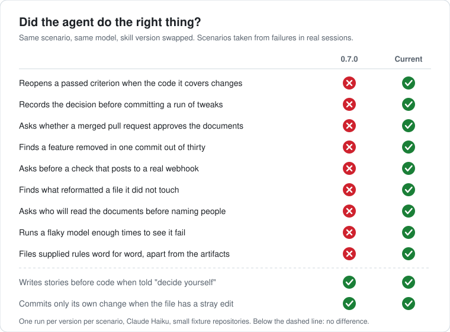

# Groundwork

An [Agent Skill](https://github.com/anthropics/skills) that writes down what a
feature must do before any code exists, then holds the code to it.



## The problem

Given a one-line request, an agent invents the missing details and builds
something plausible that nobody agreed to. More instructions in the prompt don't
fix that. A written record does. Groundwork keeps that record in `docs/` and
makes the agent read it before it writes code.

## What it produces

```
docs/
├── 00-contexto.md          -> problem, users, team, methodology and why
├── 01-alcance.md           -> in scope, out of scope, assumptions
├── 02-requisitos.md        -> functional and non-functional requirements
├── 03-arquitectura.md      -> structural decisions and the decision index
├── 04-calidad.md           -> quality attributes, verification log
├── referencias/            -> material you supplied, kept word for word
└── features/<slug>/
    ├── requisitos.md       -> requirements for this feature
    ├── historias.md        -> user stories and acceptance criteria
    ├── plan.md             -> order and dependencies
    └── decisiones.md       -> decisions made while building it
```

The files live in your repository, so anyone who opens it later has the context
without installing the skill.

Three rules govern the code once the documents exist:

1. No code without a story.
2. Record any decision someone could later want to reverse.
3. Verify by observation. What could not be observed is `blocked`, not passed.

A change smaller than its documentation skips the process.

## The checker

```sh
python <skill directory>/scripts/check_docs.py docs/
```

It fails on references to requirements, stories, criteria or decisions that
don't exist, identifiers defined twice, requirements no story covers, stories
with no criterion, and pointers to missing files. Two more modes:

- `--count <file>` gives the number of checklist items that apply to a file.
- `--status docs/` lists each story's status and the current result of every
  criterion.

It reads only identifiers and file names, so it works in any language. Whether a
criterion is observable is still for a person to judge.

## Measured

Every change in this version started as a mistake an agent made in a real
project. Each one was replayed with 0.7.0 and with this version, on the same
model. In 9 of 11, 0.7.0 made the mistake again and this version didn't. With
groundwork, your agent:

- reopens a criterion when the code it covers changes, instead of leaving it
  "passed"
- writes down the decision before it commits a run of quick tweaks
- asks whether merging a pull request approves the documents, instead of
  assuming it
- notices when a commit called "minor cleanup" removed a feature a criterion
  still requires
- asks before a check that would post to your team's real webhook
- finds out what changed a file it didn't touch before committing it
- asks who will read the documents before it writes anyone's name in them
- runs a flaky model twenty times before it calls a criterion passed
- keeps the brief or rules you hand it word for word, apart from its own files

In the other two, writing stories before code when told "decide yourself" and
committing only its own change, both versions did it right.

One trade-off was measured over ten runs: the new version mentions blocked work
more often, because it now reopens criteria. A rule written to curb that made
it worse and was removed. Each scenario ran once per version, so read these as
differences, not rates; the [changelog](CHANGELOG.md) has every run.

## What it is for

Software with users, stories and criteria someone can observe. It is not for a
project that grows by revision rather than by feature, such as a library of
prose or a skill. This repository is one of those, so it doesn't use groundwork
on itself; its changelog does that job.

## Install

```sh
npx skills add jess-devs/groundwork
```

This uses the [`skills` CLI](https://github.com/vercel-labs/skills) and installs
into the current project at `.claude/skills/groundwork`.

- Add `-g` to install for every project.
- Add `--agent claude-code` to install for one agent only.
- `npx skills update` updates it, and `npx skills remove groundwork` removes it.

Without the CLI, copy the directory:

```sh
git clone https://github.com/jess-devs/groundwork.git
cp -r groundwork/skills/groundwork ~/.claude/skills/groundwork
```

It follows the open Agent Skills standard, so the same directory works in other
agent CLIs.

## Working language

Documents are written in your language. File names and the mode names
(`new-project`, `adopt`, `new-feature`) never change, so tools and people can
find them. Those names are in Spanish because the skill was written in Spanish
first; `AGENTS.md` lists every file and what it holds.

## Repository layout

```
skills/groundwork/  -> the skill, which is what you install
  SKILL.md          -> the rules
  references/       -> interview questions, templates, methodology, checklist, rationale
  scripts/          -> check_docs.py
assets/             -> images for this README
CHANGELOG.md        -> every rule and the failure that produced it
```

Every rule exists because something went wrong without it. Read the changelog
before you remove one.

## Limitations

- **The skill can't load on repository state.** An agent picks skills from the
  words of a request, so "the app won't start" never loads it. The three rules
  are also written into `AGENTS.md`, which tools read anyway.
- **Handing work to another skill doesn't carry the criteria.** Two rewordings
  didn't change that.
- **After a long session the skill can drop out of context entirely.** Keeping
  `SKILL.md` under the size that survives compaction helps only when it is
  re-loaded at all.
- **Nothing forces the checker to run.** There is no hook or CI step.
- **The evidence can't be re-run by others.** The eval suite and the test
  scenarios are not in this repository.

## License

Apache-2.0
